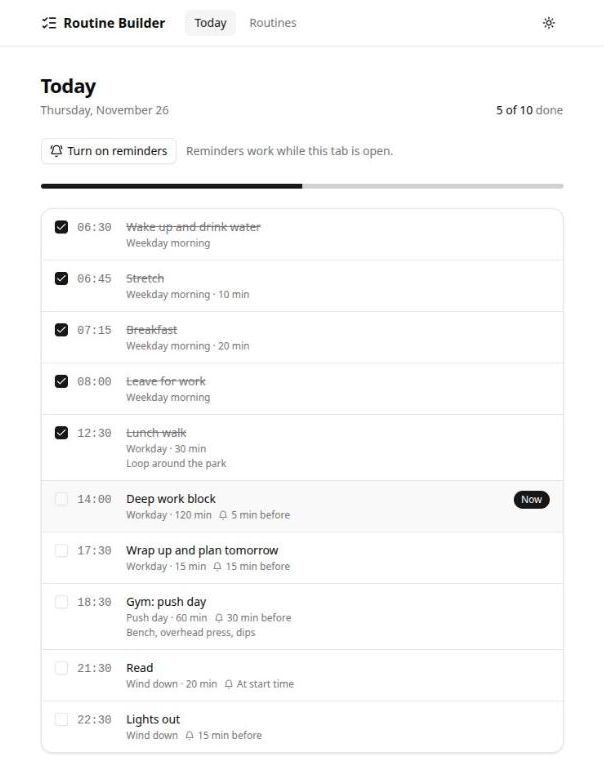
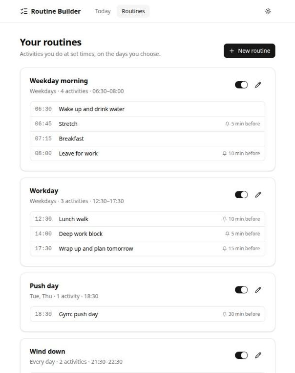

# Routine Builder

Plan your day as routines, see what's on today, and get reminded before each activity.

Create routines like "Weekday morning" or "Push day", choose the days they run, and add
activities at set times. The **Today** view merges everything scheduled for today in time
order, highlights what's next, and lets you tick things off. Reminders arrive as browser
notifications a few minutes before each activity.

<p align="center">
  
  
  
</p>

## Features

- **Routines on a schedule.** Each routine has a name, the days of the week it runs, and
  activities with a time, optional duration, notes and reminder.
- **Today view.** Every activity from today's routines in one list, with the next one
  highlighted ("Now" or "Next · in 25 min"), overdue ones marked, and a progress bar.
- **Reminders.** System notifications before an activity, from "at start time" to an hour
  before. They never repeat across reloads or tabs, and missed ones don't pile up later.
  If notifications are off, reminders appear on the page instead.
- **Editor.** Add, reorder, sort by time and remove activities, with errors shown next to
  the fields they belong to.
- **No account needed.** Data stays in your browser and is validated on every load. If
  stored data is ever unreadable, it is backed up instead of being overwritten.
- **Light and dark themes**, following your system setting or chosen in the header, and
  every action works from the keyboard.

## Tech stack

| Area      | Tools                                                                |
| --------- | -------------------------------------------------------------------- |
| App       | React 19, TypeScript (strict), Vite                                  |
| Routing   | TanStack Router with file-based routes                               |
| UI        | shadcn/ui (Radix primitives) on Tailwind CSS v4, in a shared package |
| Data      | Zod schemas as the single source of types and runtime validation     |
| Monorepo  | pnpm workspaces and Turborepo                                        |
| Quality   | Vitest, Testing Library, oxlint, Prettier                            |
| CI and CD | GitHub Actions on every pull request, Vercel for hosting             |

## Architecture

```
routine-builder/
├── apps/
│   └── web/                 React app: routes, state, storage, notifications
├── packages/
│   ├── domain/              @routine-builder/domain: schemas and pure logic
│   └── ui/                  @routine-builder/ui: shadcn components and theme
└── docs/plans/              Design plans written before each feature
```

- **`packages/domain`** holds the business rules as plain TypeScript functions: what's on
  today, which reminders are due, validating a routine. It has no React and no browser
  APIs (its tsconfig has no DOM types), so it is easy to test and can be reused by a
  server later.
- **`packages/ui`** holds the shadcn/ui components and theme tokens. Apps import components
  from it instead of writing one-off versions.
- **`apps/web`** wires them together: TanStack Router routes, a React context over a
  storage repository, and the reminder loop.

A few decisions worth calling out:

- **Times are wall-clock strings** (`"07:30"`), not timestamps, because a routine means
  "07:30 wherever I am today". Logic tests run in a fixed time zone so daylight-saving
  days are covered.
- **Storage sits behind a repository interface.** The app uses `localStorage` today; a
  server-backed version can replace it without UI changes.
- **Reminders use a 30-second check loop, not one timer per reminder**, because long
  timers drift and stop while a laptop sleeps. A Web Lock makes sure only one open tab
  shows each reminder.

The full reasoning is in [Plan 001](docs/plans/001-routine-builder-mvp.md) (product and
design) and [Plan 002](docs/plans/002-monorepo-and-shadcn.md) (monorepo and UI).

## Getting started

Requires Node 24 and pnpm 10. If you don't have pnpm, `corepack enable` installs the
version pinned in `package.json`.

```bash
git clone https://github.com/Naipei-Lantei7/routine-builder.git
cd routine-builder
pnpm install
pnpm dev          # http://localhost:5173
```

| Command                                  | What it does                                  |
| ---------------------------------------- | --------------------------------------------- |
| `pnpm dev`                               | Start the app in development mode             |
| `pnpm check`                             | Lint, typecheck, test and build every package |
| `pnpm test`                              | Run all tests                                 |
| `pnpm --filter @routine-builder/web dev` | Run a command in one package                  |
| `pnpm format`                            | Format the repo with Prettier                 |

## Testing

Business rules are tested as plain functions in `packages/domain`, including edge cases
such as reminders that fall before midnight and both daylight-saving days. The web app is
tested end to end with Testing Library: tests render the real router at a URL, use the
real storage, fix the clock, and stand in for the browser's Notification API.

## Deployment

The app is a static site. `vercel.json` tells Vercel how to install and build the monorepo
and sends every route to `index.html`, so links like `/routines` work on reload.

To deploy your own copy: import the repository in Vercel and keep the defaults. Vercel
reads the settings from `vercel.json`.

## How this project is built

Each feature starts as a numbered plan in [`docs/plans`](docs/plans), then lands as small
pull requests with [Conventional Commits](https://www.conventionalcommits.org). CI runs
format, lint, typecheck, tests and build on every pull request.

## Limitations and roadmap

Today, data lives in one browser and reminders only fire while the app is open in a tab.
Next up:

- **Streaks and history**, built from the completions already being recorded.
- **A timer** for activities with a duration.
- **A backend** (NestJS, PostgreSQL, BullMQ and Web Push) so routines sync across devices
  and reminders arrive even when the app is closed. See Plan 001, section 8.
